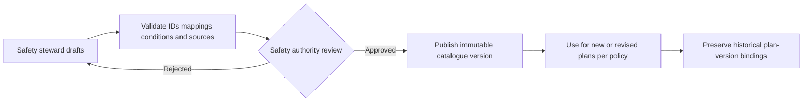

# SAF-001 — Hazard Identification Catalogue v0

| Control | Value |
|---|---|
| Product / feature | FabPilot / SAF-001 Smart Safety Plan |
| Status | **Draft — content and mappings not approved** |
| Decision basis | [SAF-DEC-001 and SAF-DEC-002](02-decision-register.md) |
| Owner | Safety Content Steward (to assign) |
| Approver | Authorized Safety Authority (to assign) |
| Related requirements | SAF-REQ-004–009, 021–024, 026, 028, 031 |
| Date | 2026-10-14 |

## 1. Purpose and boundaries

This specification defines the **structure, control and acceptance rules** for the Smart Safety Plan hazard-identification catalogue. It does **not** assert that an approved twelve-question set or approved hazard-to-control mapping exists in this repository. Hazard identification supports, but does not replace, site risk assessment, safe systems of work, PTW, LOTO or independent control verification.

**Confirmed product decision:** begin with a controlled, versioned baseline of twelve pre-task screening questions. Authorized Safety administrators may propose changes, obtain safety review and publish a new version. Existing plan revisions retain the exact question and hazard content versions used at assessment time.

## 2. Two distinct catalogue layers

| Layer | Purpose | Cardinality |
|---|---|---|
| Screening question | Ask about potentially relevant work circumstances in plain language | **12 initial baseline slots**, exact text pending approval |
| Hazard entry | Describe hazardous source/condition, event, consequence, baseline controls and references | Many hazards may map to one or several screening questions; the hazard library is **not limited to 12** |

One screening question may reveal multiple hazards. A hazard may be associated with several questions. Neither a negative response nor a hidden condition automatically proves a hazard is absent.

## 3. Proposed twelve-question baseline slots — source not yet established

**All question texts below remain UNSPECIFIED.** Do not seed these placeholders as live questions, present invented wording as approved, or interpret a blank slot as a negative answer. The authorized safety content owner must supply the exact text and the governing applicability/mapping evidence.

| Stable slot | Approved question ID | Approved text | Conditional applicability | Mapping and approval |
|---|---|---|---|---|
| Q01 | TBD | **TBD** | TBD | Missing / unapproved |
| Q02 | TBD | **TBD** | TBD | Missing / unapproved |
| Q03 | TBD | **TBD** | TBD | Missing / unapproved |
| Q04 | TBD | **TBD** | TBD | Missing / unapproved |
| Q05 | TBD | **TBD** | TBD | Missing / unapproved |
| Q06 | TBD | **TBD** | TBD | Missing / unapproved |
| Q07 | TBD | **TBD** | TBD | Missing / unapproved |
| Q08 | TBD | **TBD** | TBD | Missing / unapproved |
| Q09 | TBD | **TBD** | TBD | Missing / unapproved |
| Q10 | TBD | **TBD** | TBD | Missing / unapproved |
| Q11 | TBD | **TBD** | TBD | Missing / unapproved |
| Q12 | TBD | **TBD** | TBD | Missing / unapproved |

Before publication, every initial slot must have a unique stable ID, nonempty approved text, answer options, relevant task/equipment context, hazard mappings or documented no-mapping rationale, provenance, content version and approval evidence.

## 4. Hazard taxonomy and mapping contract

| Field | Definition / governance |
|---|---|
| Hazard ID | Stable identifier independent of display text |
| Category and name | Controlled terminology; avoid duplicate synonyms and overlapping entries |
| Hazard source or condition | Specific work exposure or energy/material source |
| Undesired event | Event that might occur if controls fail or exposure occurs |
| Consequence | Potential harm / outcome, not an invented risk score |
| Applicable task/equipment/site context | Explicit criteria and reviewed exemptions |
| Linked screening question IDs | Zero or more references, with justification when unmapped |
| Baseline controls | Proposed precautions; never default to implemented/verified |
| Required PTW / LOTO / PPE / training | References to separate governing rules; not automatic authority |
| Guidance and source | Controlled legal, equipment, company or adopted reference and version |
| Risk method version | Reference the approved SAF-DEC-002 methodology; initial and residual inputs are task-specific |
| Symbols and assets | Provenance and accessibility alternatives; unverified icons cannot be called certified |
| Publication status | Draft, in review, approved, retired (historic references retained) |

**No canonical hazard inventory or risk ratings are established by this v0 document.**

## 5. User interaction and conditional rules

1. Show screening questions in a compact, accessible progression; display help and related hazard choices when applicable.
2. A question response must distinguish **Yes**, **No**, and **Unanswered**; rules for an explicit **Unknown/Not sure** response remain for safety approval.
3. For responses requiring further assessment, reveal applicable hazard choices, events, consequences and *unverified* baseline controls.
4. The engineer may record additional task-specific hazards with attribution and justification.
5. Selected hazards, versions and their mappings carry into the Risk Assessment stage without repetitive entry.
6. Hide/show is a presentation event, **not automatic deletion**. Explicit clearing is a distinct intentional action with consistent save/revision rules.
7. Condition chains must have defined behaviour; cycles and missing referenced questions prevent publication.
8. Missing approved mapping or an unavailable catalogue must not produce speculative guidance or be interpreted as safety clearance.
9. Draft saves may be incomplete; a submitted plan must satisfy the approved required-answer and review rules.
10. In-progress approved plans must not silently change when a catalogue version is published.

## 6. Risk Assessment linkage

The selected product direction (SAF-DEC-002) uses **severity 1–3 × likelihood 1–4**, individual risk calculations, **maximum assessed risk** roll-up and **SRB trigger at index ≥6**. The relevant safety authority must still validate risk acceptance/escalation criteria and correct domain use.

Risk axes and mitigations are assessed for the **specific task**, not inherited as verified values from baseline hazard text. Empty, incomplete or invalid assessments may not be interpreted as low risk. System calculations must use one controlled method; the UI may display but must not create a second independent authority.

## 7. Governance and publication lifecycle

Only nominated actors may create, review, approve, publish or retire controlled content. Publication requires traceable actor, date, rationale and change summary. No changes to currently approved plans are implicit; migration/reassessment triggers require an approved rule.

## 8. Exceptions and safety-relevant gaps

| Exception | Required product response | Open authority decision |
|---|---|---|
| Question unanswered | Visibly incomplete; cannot be silently treated as No | Which questions mandatory for submission |
| Yes but no mapped hazards | Surface missing mapping; do not invent a risk or control | Escalation route |
| Unknown hazard / new condition | Permit attributed candidate entry, flagged for review | Required reviewer and start-work effect |
| Contradictory answers | Explain conflict and require resolution | Resolution authority |
| Conditional parent hidden | Do not expose child by stale dependency | Answer retention/clearing |
| Catalogue updated mid-draft | Explain version difference | Pin or migrate under controlled rules |
| Required content unavailable | Inform user; do not claim completed assessment | Offline/degraded mode |
| Historical version retired | Historical plans remain interpretable | Reassessment triggers |

## 9. Acceptance and traceability

| Test ID | Target evidence | SAF-REQ |
|---|---|---|
| HAZ-01 | Exactly twelve approved question slots with ID, text, applicability, revision and sign-off | 004, 021 |
| HAZ-02 | Yes/No/Unanswered and conditional hazard disclosure | 004–005, 023–024 |
| HAZ-03 | Many-to-many hazard/question mapping and provenance | 006–007, 028 |
| HAZ-04 | Selected hazard carried to assessment with no duplicate user entry | 007–008 |
| HAZ-05 | No automatic deletion of saved hidden answers | 022–024 |
| HAZ-06 | Reject cyclic conditions, orphaned mappings and unauthorized publication | 021, 024, 026 |
| HAZ-07 | Task-specific hazards and absent mapping handled without fabricated controls | 006, 009 |
| HAZ-08 | Versioned catalogue publication preserves approved plan history | 018, 026, 028 |
| HAZ-09 | Approved risk scoring and SRB boundary, with negative cases | 008–009 |
| HAZ-10 | Symbols, alternative text, responsive and keyboard usability reviewed | 016, 031 |

Tests are **planned, not executed**.

## 10. Outstanding sign-offs

- [ ] Obtain exact twelve questions, definitions and applicability from authorized source.
- [ ] Approve each hazard mapping, unwanted event, consequence and baseline control.
- [ ] Approve question conditional logic, Unknown handling and source precedence.
- [ ] Verify risk matrix, escalation and interaction with PTW/LOTO/SRB independently.
- [ ] Assign catalogue steward and publisher, establish revision/migration rules.
- [ ] Review site-specific legal/company/equipment applicability.
- [ ] Execute evidence-linked tests and obtain Product Owner + Safety Authority sign-off.

**Disposition:** Catalogue framework drafted. Hazard **content completeness remains blocked** until the actual twelve questions and mapped safety material are supplied and approved.

## 11. Reconciled source inventory — historical FabPilot FSM

**Source review (14 October 2026):** The following data are extracted from the current historical repository source files. They are **implementation/reference content**, not a published or safety-approved 12-question screening catalogue. No legacy source code has been imported into FabOps-Green.

### 11.1 Pre-task hazard selection tiles (18 entries)

Source: [NewSafetyPlan.tsx](https://github.com/sagrado26/fabpilot-fsm/blob/main/App%20files/src/active-ui/ExSafetyPlan/NewSafetyPlan.tsx). These are presentation hazard *tiles*, not the authoritative screening questions.

| Source key | Displayed hazard consideration | Description in source |
|---|---|---|
| `skills-certifications` | Skills or certifications required | Confirm the required training, authorization, or certification. |
| `permit-to-work` | Permit to Work | A governed permit is required for this task or work area. |
| `combustible-flammable-toxic` | Combustible / flammable / toxic materials | Exposure to hazardous substances or combustible materials. |
| `radiation` | Ionizing / Radio / Electromagnetic radiation | Ionizing, radio-frequency, or electromagnetic-field exposure. |
| `hazardous-energy` | Hazardous energy sources | Electrical, mechanical, pneumatic, hydraulic, or stored energy. |
| `temperature` | High / low temperature objects | Hot or cold surfaces, fluids, or equipment. |
| `environmental` | Environmental hazards | Noise, lighting, weather, ventilation, or surrounding conditions. |
| `work-above-four-feet` | Work above 4 ft | Work at height above 4 ft / 1.2 m. |
| `falling-objects` | Falling objects | Tools, parts, or materials may fall. |
| `open-floors-holes` | Open floors or holes | Floor tiles, penetrations, or unprotected openings. |
| `ergonomic` | Ergonomic risks | Awkward posture, repetition, or constrained access. |
| `manual-lifting` | Manual lifting >35 lbs | Manual handling above 35 lbs / 15.9 kg. |
| `crane-use` | Crane use | A hoist, crane, or lifting device is required. |
| `line-of-fire` | Line of fire | Potential crush, strike, pinch, or release path. |
| `heavy-material-movement` | Heavy material movement | Movement of heavy parts, carts, or equipment. |
| `permanent-magnetic-fields` | Permanent magnetic fields | Exposure to permanent magnetic fields. |
| `oxygen-deficiency` | Oxygen deficiency / asphyxiants | Confined-space or displaced-oxygen risk. |
| `other-risks` | Other risks | Additional risks not listed above. |

### 11.2 Current wizard hazard-to-library suggestions

Source: [NewSafetyPlan.tsx](https://github.com/sagrado26/fabpilot-fsm/blob/main/App%20files/src/active-ui/ExSafetyPlan/NewSafetyPlan.tsx), `CHECK_HAZ` map. Labels without a source map are left unmapped, rather than invented.

| Pre-task consideration | Suggested hazard catalogue names |
|---|---|
| Skills or certifications required | Confined Space; Hoisting or Crane Use |
| Combustible / flammable / toxic materials | Combustible / Flammable; Toxic Materials |
| Ionizing / Radio / Electromagnetic radiation | Ionizing / EM Radiation; Optical Radiation |
| Hazardous energy sources | Electrical Work (LOTO); Mechanical Hazards; Fluids (Water, Gas, Vacuum) |
| High / low temperature objects | High or Low Temperature |
| Environmental hazards | Noise |
| Work above 4 ft | Working at Height |
| Falling objects | Falling Objects / Safety Netting |
| Open floors or holes | Floor tile lift / Barricades |
| Ergonomic risks | Ergonomic Risk |
| Manual lifting >35 lbs | +35 lb Manual Lifts |
| Crane use | Hoisting or Crane Use |
| Line of fire | Pinch Points; Mechanical Hazards |
| Heavy material movement | Material Movements |
| Permanent magnetic fields | Permanent Magnetic Fields |
| Oxygen deficiency / asphyxiants | Lack of Oxygen; Confined Space |

### 11.3 Earlier configurable pre-task check legacy guide

Source: [ExCreate/data.ts](https://github.com/sagrado26/fabpilot-fsm/blob/main/App%20files/src/active-ui/ex-create/ExCreate/data.ts), `CHECK_HAZ` map. The file explicitly says its eleven historical screening tiles were replaced with administrator-configurable Yes/No check definitions, and this list survives as a *Hazard Relationship Guide*, not live question authority.

| Historic guide label | Suggested hazard catalogue names |
|---|---|
| Heavy Lifting | +35 lb Manual Lifts; Material Movements |
| LOTO Required | Electrical Work (LOTO) |
| Chemicals / Hazmat | Toxic Materials; Combustible / Flammable; Lack of Oxygen |
| Fall Hazard | Working at Height; Falling Objects / Safety Netting |
| Barricades Required | Floor tile lift / Barricades |
| Ergonomic Concerns | Ergonomic Risk |
| Head Injury Risk | Falling Objects / Safety Netting |
| Specialized Training | Confined Space; Hoisting or Crane Use |
| Other Work in Area | Floor tile lift / Barricades |
| Additional PPE | Confined Space; Electrical Work (LOTO) |

### 11.4 Governed active-question source, not a fixed array

- [Pre-task checks query](https://github.com/sagrado26/fabpilot-fsm/blob/main/App%20files/deployment-domain/queries/src/pre-task-checks.ts) reads active `PreTaskCheckDefinition` records ordered by sort position and code, including their authored question text.
- [Pre-task checks command](https://github.com/sagrado26/fabpilot-fsm/blob/main/App%20files/deployment-domain/commands/src/pre-task-checks.ts) provides audited configuration changes, permissions and retirement rules.
- [Pre-task check UI](https://github.com/sagrado26/fabpilot-fsm/blob/main/App%20files/src/active-ui/ex-create/ExCreate/pre-task-checks.tsx) displays one Yes/No question per active definition.
- **The exact currently active definition records are data-dependent**. Reading source files does not establish the live site's twelve question texts, versions or answers. They must be exported from the authoritative configuration, validated, and linked to a safety approval record.

### 11.5 Differences to resolve before publishing v0

| Discrepancy | Finding | Action |
|---|---|---|
| 12 versus 11 versus 18 | Product direction sets a baseline of 12 controlled questions; the legacy relationship guide has 11 categories; the wizard shows 18 hazard tiles. | Treat as three distinct layers, not matching question counts; obtain actual twelve approved question records. |
| Duplicate mappings | “Hoisting or Crane Use”, mechanical hazards and confined-space-related entries appear in multiple mappings. | Model many-to-many relations, preserve provenance; do not duplicate risk records automatically. |
| Missing mapping | Some wizard hazard tiles have no `CHECK_HAZ` suggestion and the historic catch-all deliberately maps to no single hazard. | Mark unmapped; require a defined safe review pathway. |
| Source version and authority | UI defaults and guide labels differ from controlled, published question definitions. | Require accountable Safety Content Steward to select, approve and version the baseline. |
| Hazard risk details | Source supports description and suggested controls, but does not itself certify task-specific risk or implemented controls. | Keep actual initial/residual assessment and control verification separate. |

**Disposition:** Real historical labels/mappings recovered. The twelve controlled screening question contents and approved mapping remain a targeted source-data/approval gap, not twelve undiscovered UI labels.

## 12. Source-authority conflict: original questions versus current FabPilot checks

**Critical historical correction:** The FabPilot [Green Belt Project Vision](https://github.com/sagrado26/fabpilot-fsm/blob/main/Documentation/GREEN-BELT-PROJECT-VISION.html) contains an explicit **11 September 2026 RETRACTION** of an earlier claim that its governing pre-task schema contained twelve fixed questions. The document says an actual read of `ISP_USER_GUIDE_WORD.docx` found **eleven** Yes/No questions for the separate `safety-plan.asml.com` reference workflow. It also states the applicable FabPilot FRS (`FR-SM-002`) defined **four** governed checks, with `FR-SM-003` applying submission rules. Later active pre-task check definitions became configurable.

The four documented FR-SM-002 concepts are:

1. Is a Permit to Work required?
2. Does a procedure or action plan exist?
3. Is the person aware of COHE / Way of Working?
4. Is safety training up to date?

**Text status:** These four lines are normalized renderings of the FRS text quoted in the vision, not a verified exact live question-label export. Their identity is more strongly grounded than the unsubstantiated twelve fixed `q1…q12` claim.

### Baseline reconciliation decision required

The Product Owner selected **twelve configurable baseline questions** in SAF-DEC-001 for FabOps-Green. That is an intentional **new product baseline direction**, but the available historical sources do not establish twelve original verbatim question texts. The eleven-question separate reference tool, eighteen selectable hazard tiles, ten/eleven legacy guide categories and four governed checks cannot be assembled into twelve without an explicit content-authority decision.

**Do not claim a faithful verbatim reconstruction has been completed.** To resolve this discrepancy, identify whether the intended FabOps-Green content should adopt the separate reference tool's eleven questions and add one authorized item, use the four governed checks plus eight approved additions, or use another source document. No choice is made by this draft.

Related decision: [SAF-DEC-001](02-decision-register.md); acceptance HAZ-01 remains blocked.
