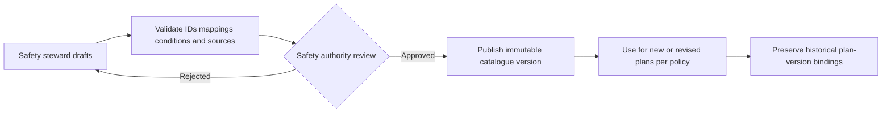

# SAF-001 — Hazard Identification Catalogue v0

| Control | Value |
|---|---|
| Product / feature | FabPilot / SAF-001 Smart Safety Plan |
| Status | **Draft — content and mappings not approved** |
| Decision basis | [SAF-DEC-001 and SAF-DEC-002](02-decision-register.md) |
| Owner | Safety Content Steward (to assign) |
| Approver | Authorized Safety Authority (to assign) |
| Related requirements | SAF-REQ-004–009, 021–024, 026, 028, 031 |
| Date | 2026-10-14 |

## 1. Purpose and boundaries

This specification defines the **structure, control and acceptance rules** for the Smart Safety Plan hazard-identification catalogue. It does **not** assert that an approved twelve-question set or approved hazard-to-control mapping exists in this repository. Hazard identification supports, but does not replace, site risk assessment, safe systems of work, PTW, LOTO or independent control verification.

**Confirmed product decision:** begin with a controlled, versioned baseline of twelve pre-task screening questions. Authorized Safety administrators may propose changes, obtain safety review and publish a new version. Existing plan revisions retain the exact question and hazard content versions used at assessment time.

## 2. Two distinct catalogue layers

| Layer | Purpose | Cardinality |
|---|---|---|
| Screening question | Ask about potentially relevant work circumstances in plain language | **12 initial baseline slots**, exact text pending approval |
| Hazard entry | Describe hazardous source/condition, event, consequence, baseline controls and references | Many hazards may map to one or several screening questions; the hazard library is **not limited to 12** |

One screening question may reveal multiple hazards. A hazard may be associated with several questions. Neither a negative response nor a hidden condition automatically proves a hazard is absent.

## 3. Baseline question register — twelve controlled slots

**All question texts below remain UNSPECIFIED.** Do not seed these placeholders as live questions, present invented wording as approved, or interpret a blank slot as a negative answer. The authorized safety content owner must supply the exact text and the governing applicability/mapping evidence.

| Stable slot | Approved question ID | Approved text | Conditional applicability | Mapping and approval |
|---|---|---|---|---|
| Q01 | TBD | **TBD** | TBD | Missing / unapproved |
| Q02 | TBD | **TBD** | TBD | Missing / unapproved |
| Q03 | TBD | **TBD** | TBD | Missing / unapproved |
| Q04 | TBD | **TBD** | TBD | Missing / unapproved |
| Q05 | TBD | **TBD** | TBD | Missing / unapproved |
| Q06 | TBD | **TBD** | TBD | Missing / unapproved |
| Q07 | TBD | **TBD** | TBD | Missing / unapproved |
| Q08 | TBD | **TBD** | TBD | Missing / unapproved |
| Q09 | TBD | **TBD** | TBD | Missing / unapproved |
| Q10 | TBD | **TBD** | TBD | Missing / unapproved |
| Q11 | TBD | **TBD** | TBD | Missing / unapproved |
| Q12 | TBD | **TBD** | TBD | Missing / unapproved |

Before publication, every initial slot must have a unique stable ID, nonempty approved text, answer options, relevant task/equipment context, hazard mappings or documented no-mapping rationale, provenance, content version and approval evidence.

## 4. Hazard taxonomy and mapping contract

| Field | Definition / governance |
|---|---|
| Hazard ID | Stable identifier independent of display text |
| Category and name | Controlled terminology; avoid duplicate synonyms and overlapping entries |
| Hazard source or condition | Specific work exposure or energy/material source |
| Undesired event | Event that might occur if controls fail or exposure occurs |
| Consequence | Potential harm / outcome, not an invented risk score |
| Applicable task/equipment/site context | Explicit criteria and reviewed exemptions |
| Linked screening question IDs | Zero or more references, with justification when unmapped |
| Baseline controls | Proposed precautions; never default to implemented/verified |
| Required PTW / LOTO / PPE / training | References to separate governing rules; not automatic authority |
| Guidance and source | Controlled legal, equipment, company or adopted reference and version |
| Risk method version | Reference the approved SAF-DEC-002 methodology; initial and residual inputs are task-specific |
| Symbols and assets | Provenance and accessibility alternatives; unverified icons cannot be called certified |
| Publication status | Draft, in review, approved, retired (historic references retained) |

**No canonical hazard inventory or risk ratings are established by this v0 document.**

## 5. User interaction and conditional rules

1. Show screening questions in a compact, accessible progression; display help and related hazard choices when applicable.
2. A question response must distinguish **Yes**, **No**, and **Unanswered**; rules for an explicit **Unknown/Not sure** response remain for safety approval.
3. For responses requiring further assessment, reveal applicable hazard choices, events, consequences and *unverified* baseline controls.
4. The engineer may record additional task-specific hazards with attribution and justification.
5. Selected hazards, versions and their mappings carry into the Risk Assessment stage without repetitive entry.
6. Hide/show is a presentation event, **not automatic deletion**. Explicit clearing is a distinct intentional action with consistent save/revision rules.
7. Condition chains must have defined behaviour; cycles and missing referenced questions prevent publication.
8. Missing approved mapping or an unavailable catalogue must not produce speculative guidance or be interpreted as safety clearance.
9. Draft saves may be incomplete; a submitted plan must satisfy the approved required-answer and review rules.
10. In-progress approved plans must not silently change when a catalogue version is published.

## 6. Risk Assessment linkage

The selected product direction (SAF-DEC-002) uses **severity 1–3 × likelihood 1–4**, individual risk calculations, **maximum assessed risk** roll-up and **SRB trigger at index ≥6**. The relevant safety authority must still validate risk acceptance/escalation criteria and correct domain use.

Risk axes and mitigations are assessed for the **specific task**, not inherited as verified values from baseline hazard text. Empty, incomplete or invalid assessments may not be interpreted as low risk. System calculations must use one controlled method; the UI may display but must not create a second independent authority.

## 7. Governance and publication lifecycle

Only nominated actors may create, review, approve, publish or retire controlled content. Publication requires traceable actor, date, rationale and change summary. No changes to currently approved plans are implicit; migration/reassessment triggers require an approved rule.

## 8. Exceptions and safety-relevant gaps

| Exception | Required product response | Open authority decision |
|---|---|---|
| Question unanswered | Visibly incomplete; cannot be silently treated as No | Which questions mandatory for submission |
| Yes but no mapped hazards | Surface missing mapping; do not invent a risk or control | Escalation route |
| Unknown hazard / new condition | Permit attributed candidate entry, flagged for review | Required reviewer and start-work effect |
| Contradictory answers | Explain conflict and require resolution | Resolution authority |
| Conditional parent hidden | Do not expose child by stale dependency | Answer retention/clearing |
| Catalogue updated mid-draft | Explain version difference | Pin or migrate under controlled rules |
| Required content unavailable | Inform user; do not claim completed assessment | Offline/degraded mode |
| Historical version retired | Historical plans remain interpretable | Reassessment triggers |

## 9. Acceptance and traceability

| Test ID | Target evidence | SAF-REQ |
|---|---|---|
| HAZ-01 | Exactly twelve approved question slots with ID, text, applicability, revision and sign-off | 004, 021 |
| HAZ-02 | Yes/No/Unanswered and conditional hazard disclosure | 004–005, 023–024 |
| HAZ-03 | Many-to-many hazard/question mapping and provenance | 006–007, 028 |
| HAZ-04 | Selected hazard carried to assessment with no duplicate user entry | 007–008 |
| HAZ-05 | No automatic deletion of saved hidden answers | 022–024 |
| HAZ-06 | Reject cyclic conditions, orphaned mappings and unauthorized publication | 021, 024, 026 |
| HAZ-07 | Task-specific hazards and absent mapping handled without fabricated controls | 006, 009 |
| HAZ-08 | Versioned catalogue publication preserves approved plan history | 018, 026, 028 |
| HAZ-09 | Approved risk scoring and SRB boundary, with negative cases | 008–009 |
| HAZ-10 | Symbols, alternative text, responsive and keyboard usability reviewed | 016, 031 |

Tests are **planned, not executed**.

## 10. Outstanding sign-offs

- [ ] Obtain exact twelve questions, definitions and applicability from authorized source.
- [ ] Approve each hazard mapping, unwanted event, consequence and baseline control.
- [ ] Approve question conditional logic, Unknown handling and source precedence.
- [ ] Verify risk matrix, escalation and interaction with PTW/LOTO/SRB independently.
- [ ] Assign catalogue steward and publisher, establish revision/migration rules.
- [ ] Review site-specific legal/company/equipment applicability.
- [ ] Execute evidence-linked tests and obtain Product Owner + Safety Authority sign-off.

**Disposition:** Catalogue framework drafted. Hazard **content completeness remains blocked** until the actual twelve questions and mapped safety material are supplied and approved.
