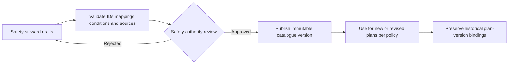

# SAF-001 — Hazard Identification Catalogue v0

| Control | Value |
|---|---|
| Product / feature | FabPilot / SAF-001 Smart Safety Plan |
| Status | **Draft — content and mappings not approved** |
| Decision basis | [SAF-DEC-001 and SAF-DEC-002](02-decision-register.md) |
| Owner | Safety Content Steward (to assign) |
| Approver | Authorized Safety Authority (to assign) |
| Related requirements | SAF-REQ-004–009, 021–024, 026, 028, 031 |
| Date | 2026-10-14 |

## 1. Purpose and boundaries

This specification defines the **structure, control and acceptance rules** for the Smart Safety Plan hazard-identification catalogue. It does **not** assert that an approved twelve-question set or approved hazard-to-control mapping exists in this repository. Hazard identification supports, but does not replace, site risk assessment, safe systems of work, PTW, LOTO or independent control verification.

**Confirmed product decision:** begin with a controlled, versioned baseline of twelve pre-task screening questions. Authorized Safety administrators may propose changes, obtain safety review and publish a new version. Existing plan revisions retain the exact question and hazard content versions used at assessment time.

## 2. Two distinct catalogue layers

| Layer | Purpose | Cardinality |
|---|---|---|
| Screening question | Ask about potentially relevant work circumstances in plain language | **12 initial baseline slots**, exact text pending approval |
| Hazard entry | Describe hazardous source/condition, event, consequence, baseline controls and references | Many hazards may map to one or several screening questions; the hazard library is **not limited to 12** |

One screening question may reveal multiple hazards. A hazard may be associated with several questions. Neither a negative response nor a hidden condition automatically proves a hazard is absent.

## 3. Twelve source-backed screening questions

These are the **verbatim question wordings** supplied in the owner's ISP specification, §4.2 (9 October 2026). The later §14 expressly settles the intended count at **12**. Each response offers **suggested, optional** hazard selections for the assessor's judgment; screening does not itself insert confirmed risk rows or trigger SRB.

| # | Screening question — source wording | Worked examples | Suggested register hazards |
|---|---|---|---|
| Q1 | Do any of the procedures require specialized training? | Confined Space; QEW; H2; Crane Operator; Stacker/Forklift | Confined Space; Electrical Work where LOTO is required; Combustible/flammable; Hoisting or crane use; Material movements |
| Q2 | Will task involve use of chemicals or hazardous material? | Chemicals; Hazardous Material | Toxic materials and substances |
| Q3 | Is other work happening in the area that will impact task? | Nearby maintenance; Other contractors/trades | Other Risks (SIMOPS) |
| Q4 | Will work involve exposure to falls of 4 feet (1.2m) or greater? | Elevated work platform; Ladder Work | Working at height |
| Q5 | Will work require barricades (trip floor tile removal, etc)? | Floor tile removal; Temporary obstruction | Floor tile lift / Barricades needed |
| Q6 | Does any work require LOTO? (Transfer/Validation of Locks or Hardware Installation) | Transfer of Locks; Validation of Locks; Hardware Installation | Electrical Work where LOTO is required |
| Q7 | Will the work require lifting or hoisting >35lbs/15.9kg? | Manual Lift >35lbs; Hoisting Activity | Ergo Risk; Hoisting or crane use |
| Q8 | Any abnormal ergonomic concerns (moving heavy items, etc)? | Moving heavy items; Awkward posture; Repetitive movement | Ergo Risk involved with this action |
| Q9 | Any other concerns about safety? | Unidentified hazard | Other Risks |
| Q10 | Is there a head injury risk? (Hard hat / Bump cap guidance) | Overhead crane; Falling objects; Overhead modules; Under floor | Falling objects / Safety Netting; Mechanical |
| Q11 | Other PPE Needed? (Knee pads / Cut-resistant gloves …) | Knee pads; Cut-resistant gloves; Sharp edges; Sharp tools | Ergo Risk; Mechanical |
| Q12 | Are you able to maintain social distancing of 6ft? | Unable to maintain 6ft | Other Risks |

**Q11 is a control question rather than a hazard question** and should present additional safety controls, not mislabel PPE as a hazard. Q12's operational relevance and active applicability can be configured through the governed catalogue without deleting the source record.

## 4. Hazard taxonomy and mapping contract

| Field | Definition / governance |
|---|---|
| Hazard ID | Stable identifier independent of display text |
| Category and name | Controlled terminology; avoid duplicate synonyms and overlapping entries |
| Hazard source or condition | Specific work exposure or energy/material source |
| Undesired event | Event that might occur if controls fail or exposure occurs |
| Consequence | Potential harm / outcome, not an invented risk score |
| Applicable task/equipment/site context | Explicit criteria and reviewed exemptions |
| Linked screening question IDs | Zero or more references, with justification when unmapped |
| Baseline controls | Proposed precautions; never default to implemented/verified |
| Required PTW / LOTO / PPE / training | References to separate governing rules; not automatic authority |
| Guidance and source | Controlled legal, equipment, company or adopted reference and version |
| Risk method version | Reference the approved SAF-DEC-002 methodology; initial and residual inputs are task-specific |
| Symbols and assets | Provenance and accessibility alternatives; unverified icons cannot be called certified |
| Publication status | Draft, in review, approved, retired (historic references retained) |

**No canonical hazard inventory or risk ratings are established by this v0 document.**

## 5. User interaction and conditional rules

1. Show screening questions in a compact, accessible progression; display help and related hazard choices when applicable.
2. A question response must distinguish **Yes**, **No**, and **Unanswered**; rules for an explicit **Unknown/Not sure** response remain for safety approval.
3. For responses requiring further assessment, reveal applicable hazard choices, events, consequences and *unverified* baseline controls.
4. The engineer may record additional task-specific hazards with attribution and justification.
5. Selected hazards, versions and their mappings carry into the Risk Assessment stage without repetitive entry.
6. Hide/show is a presentation event, **not automatic deletion**. Explicit clearing is a distinct intentional action with consistent save/revision rules.
7. Condition chains must have defined behaviour; cycles and missing referenced questions prevent publication.
8. Missing approved mapping or an unavailable catalogue must not produce speculative guidance or be interpreted as safety clearance.
9. Draft saves may be incomplete; a submitted plan must satisfy the approved required-answer and review rules.
10. In-progress approved plans must not silently change when a catalogue version is published.

## 6. Risk Assessment linkage

The selected product direction (SAF-DEC-002) uses **severity 1–3 × likelihood 1–4**, individual risk calculations, **maximum assessed risk** roll-up and **SRB trigger at index ≥6**. The relevant safety authority must still validate risk acceptance/escalation criteria and correct domain use.

Risk axes and mitigations are assessed for the **specific task**, not inherited as verified values from baseline hazard text. Empty, incomplete or invalid assessments may not be interpreted as low risk. System calculations must use one controlled method; the UI may display but must not create a second independent authority.

## 7. Governance and publication lifecycle

Only nominated actors may create, review, approve, publish or retire controlled content. Publication requires traceable actor, date, rationale and change summary. No changes to currently approved plans are implicit; migration/reassessment triggers require an approved rule.

## 8. Exceptions and safety-relevant gaps

| Exception | Required product response | Open authority decision |
|---|---|---|
| Question unanswered | Visibly incomplete; cannot be silently treated as No | Which questions mandatory for submission |
| Yes but no mapped hazards | Surface missing mapping; do not invent a risk or control | Escalation route |
| Unknown hazard / new condition | Permit attributed candidate entry, flagged for review | Required reviewer and start-work effect |
| Contradictory answers | Explain conflict and require resolution | Resolution authority |
| Conditional parent hidden | Do not expose child by stale dependency | Answer retention/clearing |
| Catalogue updated mid-draft | Explain version difference | Pin or migrate under controlled rules |
| Required content unavailable | Inform user; do not claim completed assessment | Offline/degraded mode |
| Historical version retired | Historical plans remain interpretable | Reassessment triggers |

## 9. Acceptance and traceability

| Test ID | Target evidence | SAF-REQ |
|---|---|---|
| HAZ-01 | Exactly twelve approved question slots with ID, text, applicability, revision and sign-off | 004, 021 |
| HAZ-02 | Yes/No/Unanswered and conditional hazard disclosure | 004–005, 023–024 |
| HAZ-03 | Many-to-many hazard/question mapping and provenance | 006–007, 028 |
| HAZ-04 | Selected hazard carried to assessment with no duplicate user entry | 007–008 |
| HAZ-05 | No automatic deletion of saved hidden answers | 022–024 |
| HAZ-06 | Reject cyclic conditions, orphaned mappings and unauthorized publication | 021, 024, 026 |
| HAZ-07 | Task-specific hazards and absent mapping handled without fabricated controls | 006, 009 |
| HAZ-08 | Versioned catalogue publication preserves approved plan history | 018, 026, 028 |
| HAZ-09 | Approved risk scoring and SRB boundary, with negative cases | 008–009 |
| HAZ-10 | Symbols, alternative text, responsive and keyboard usability reviewed | 016, 031 |

Tests are **planned, not executed**.

## 10. Outstanding sign-offs

- [x] Recover the exact twelve screening question wordings and 31 worked examples from the owner-supplied ISP specification (§4.2 and §10).
- [ ] Validate version-controlled site applicability and approve the baseline for operational use.
- [ ] Approve each hazard mapping, unwanted event, consequence and baseline control.
- [ ] Approve question conditional logic, Unknown handling and source precedence.
- [ ] Verify risk matrix, escalation and interaction with PTW/LOTO/SRB independently.
- [ ] Assign catalogue steward and publisher, establish revision/migration rules.
- [ ] Review site-specific legal/company/equipment applicability.
- [ ] Execute evidence-linked tests and obtain Product Owner + Safety Authority sign-off.

**Disposition:** Catalogue framework drafted. Hazard **content completeness remains blocked** until the actual twelve questions and mapped safety material are supplied and approved.

## 11. Reconciled source inventory — historical FabPilot FSM

**Source review (14 October 2026):** The following data are extracted from the current historical repository source files. They are **implementation/reference content**, not a published or safety-approved 12-question screening catalogue. No legacy source code has been imported into FabOps-Green.

### 11.1 Pre-task hazard selection tiles (18 entries)

Source: [NewSafetyPlan.tsx](https://github.com/sagrado26/fabpilot-fsm/blob/main/App%20files/src/active-ui/ExSafetyPlan/NewSafetyPlan.tsx). These are presentation hazard *tiles*, not the authoritative screening questions.

| Source key | Displayed hazard consideration | Description in source |
|---|---|---|
| `skills-certifications` | Skills or certifications required | Confirm the required training, authorization, or certification. |
| `permit-to-work` | Permit to Work | A governed permit is required for this task or work area. |
| `combustible-flammable-toxic` | Combustible / flammable / toxic materials | Exposure to hazardous substances or combustible materials. |
| `radiation` | Ionizing / Radio / Electromagnetic radiation | Ionizing, radio-frequency, or electromagnetic-field exposure. |
| `hazardous-energy` | Hazardous energy sources | Electrical, mechanical, pneumatic, hydraulic, or stored energy. |
| `temperature` | High / low temperature objects | Hot or cold surfaces, fluids, or equipment. |
| `environmental` | Environmental hazards | Noise, lighting, weather, ventilation, or surrounding conditions. |
| `work-above-four-feet` | Work above 4 ft | Work at height above 4 ft / 1.2 m. |
| `falling-objects` | Falling objects | Tools, parts, or materials may fall. |
| `open-floors-holes` | Open floors or holes | Floor tiles, penetrations, or unprotected openings. |
| `ergonomic` | Ergonomic risks | Awkward posture, repetition, or constrained access. |
| `manual-lifting` | Manual lifting >35 lbs | Manual handling above 35 lbs / 15.9 kg. |
| `crane-use` | Crane use | A hoist, crane, or lifting device is required. |
| `line-of-fire` | Line of fire | Potential crush, strike, pinch, or release path. |
| `heavy-material-movement` | Heavy material movement | Movement of heavy parts, carts, or equipment. |
| `permanent-magnetic-fields` | Permanent magnetic fields | Exposure to permanent magnetic fields. |
| `oxygen-deficiency` | Oxygen deficiency / asphyxiants | Confined-space or displaced-oxygen risk. |
| `other-risks` | Other risks | Additional risks not listed above. |

### 11.2 Current wizard hazard-to-library suggestions

Source: [NewSafetyPlan.tsx](https://github.com/sagrado26/fabpilot-fsm/blob/main/App%20files/src/active-ui/ExSafetyPlan/NewSafetyPlan.tsx), `CHECK_HAZ` map. Labels without a source map are left unmapped, rather than invented.

| Pre-task consideration | Suggested hazard catalogue names |
|---|---|
| Skills or certifications required | Confined Space; Hoisting or Crane Use |
| Combustible / flammable / toxic materials | Combustible / Flammable; Toxic Materials |
| Ionizing / Radio / Electromagnetic radiation | Ionizing / EM Radiation; Optical Radiation |
| Hazardous energy sources | Electrical Work (LOTO); Mechanical Hazards; Fluids (Water, Gas, Vacuum) |
| High / low temperature objects | High or Low Temperature |
| Environmental hazards | Noise |
| Work above 4 ft | Working at Height |
| Falling objects | Falling Objects / Safety Netting |
| Open floors or holes | Floor tile lift / Barricades |
| Ergonomic risks | Ergonomic Risk |
| Manual lifting >35 lbs | +35 lb Manual Lifts |
| Crane use | Hoisting or Crane Use |
| Line of fire | Pinch Points; Mechanical Hazards |
| Heavy material movement | Material Movements |
| Permanent magnetic fields | Permanent Magnetic Fields |
| Oxygen deficiency / asphyxiants | Lack of Oxygen; Confined Space |

### 11.3 Earlier configurable pre-task check legacy guide

Source: [ExCreate/data.ts](https://github.com/sagrado26/fabpilot-fsm/blob/main/App%20files/src/active-ui/ex-create/ExCreate/data.ts), `CHECK_HAZ` map. The file explicitly says its eleven historical screening tiles were replaced with administrator-configurable Yes/No check definitions, and this list survives as a *Hazard Relationship Guide*, not live question authority.

| Historic guide label | Suggested hazard catalogue names |
|---|---|
| Heavy Lifting | +35 lb Manual Lifts; Material Movements |
| LOTO Required | Electrical Work (LOTO) |
| Chemicals / Hazmat | Toxic Materials; Combustible / Flammable; Lack of Oxygen |
| Fall Hazard | Working at Height; Falling Objects / Safety Netting |
| Barricades Required | Floor tile lift / Barricades |
| Ergonomic Concerns | Ergonomic Risk |
| Head Injury Risk | Falling Objects / Safety Netting |
| Specialized Training | Confined Space; Hoisting or Crane Use |
| Other Work in Area | Floor tile lift / Barricades |
| Additional PPE | Confined Space; Electrical Work (LOTO) |

### 11.4 Governed active-question source, not a fixed array

- [Pre-task checks query](https://github.com/sagrado26/fabpilot-fsm/blob/main/App%20files/deployment-domain/queries/src/pre-task-checks.ts) reads active `PreTaskCheckDefinition` records ordered by sort position and code, including their authored question text.
- [Pre-task checks command](https://github.com/sagrado26/fabpilot-fsm/blob/main/App%20files/deployment-domain/commands/src/pre-task-checks.ts) provides audited configuration changes, permissions and retirement rules.
- [Pre-task check UI](https://github.com/sagrado26/fabpilot-fsm/blob/main/App%20files/src/active-ui/ex-create/ExCreate/pre-task-checks.tsx) displays one Yes/No question per active definition.
- **Important distinction:** Historic FabPilot live active-check records are data-dependent. The supplied ISP specification now establishes the intended **twelve product-baseline question texts**. Live site configurations and publication/sign-off remain separately verifiable.

### 11.5 Differences to resolve before publishing v0

| Discrepancy | Finding | Action |
|---|---|---|
| 12 versus 11 versus 18 | Product direction sets a baseline of 12 controlled questions; the legacy relationship guide has 11 categories; the wizard shows 18 hazard tiles. | Treat as three distinct layers, not matching question counts; obtain actual twelve approved question records. |
| Duplicate mappings | “Hoisting or Crane Use”, mechanical hazards and confined-space-related entries appear in multiple mappings. | Model many-to-many relations, preserve provenance; do not duplicate risk records automatically. |
| Missing mapping | Some wizard hazard tiles have no `CHECK_HAZ` suggestion and the historic catch-all deliberately maps to no single hazard. | Mark unmapped; require a defined safe review pathway. |
| Source version and authority | UI defaults and guide labels differ from controlled, published question definitions. | Require accountable Safety Content Steward to select, approve and version the baseline. |
| Hazard risk details | Source supports description and suggested controls, but does not itself certify task-specific risk or implemented controls. | Keep actual initial/residual assessment and control verification separate. |

**Disposition:** Real historical labels/mappings recovered. The twelve controlled screening question contents and approved mapping remain a targeted source-data/approval gap, not twelve undiscovered UI labels.

## 12. Historical provenance and supersession

An earlier FabPilot Green Belt document (11 September 2026) retracted an unsupported *then-current implementation* claim of twelve fixed pre-task checks and pointed to four governed operational checks. **That historical correction is valid for its own scope**, but it does not supersede the later owner-supplied ISP specification of **9 October 2026**, which explicitly supplies 12 screening questions in §4.2 and confirms that count in §14.

Distinguish the datasets: the older eleven-question reference guide, four configurable operational checks, eighteen hazard tiles and the newer twelve-question ISP screen are not interchangeable. For the **FabOps-Green ISP product reconstruction**, the supplied twelve question texts and thirty-one worked example rows are the baseline source. Safety-content applicability and publication approval remain independent governance tasks.

## 13. Supplied ISP specification — precedence and corrections

The owner-provided *ISP — Integrated Safety Plan: Specification*, dated **9 October 2026**, supersedes earlier FabPilot history for the clean product rebuild where it records later owner decisions. §4.2 supplies the exact 12 questions; §10 supplies 31 example rows. **This closes the missing-wording claim in our earlier draft**; the content still needs governance approval before actual field use.

- **Risk bands:** Low 0–3; Medium 4–6; High 7–12. **SRB trigger remains index ≥6**, separately, meaning 6 is *Medium* and invokes SRB. This differs from legacy ADR-0026 risk-band labels.
- **Risk roll-up:** highest *individual* hazard S×L; never worst severity multiplied by worst likelihood from different hazards. Source baseline risk is confirmable guidance, not a recorded scored risk until accepted by the assessor. Whether to prefill initial values remains expressly **OPEN** (§14).
- **Step 2 → Step 3:** screening suggests hazard pills that can be accepted, added to or ignored; Step 3 owns the scored hazard register.
- **PTW:** §14 (9 October owner correction) establishes an additional **Hazardous Chemicals and Materials Permit**, distinct from Hazardous Space Permit. This overrides the earlier “six only” rule. Hazards including Tin Dust may require the named permit while IPA, N₂ and CO₂ do not under the specified material mapping; Safety Engineers configure mandatory assignments.
- **Hazardous Space:** owner directs adding this distinct hazard linked to Hazardous Space Permit with configurable checklist/training.
- **PPE:** ten mandatory code references (M003, M014, M008, M004, M018, M017, M010, M009, M015, M016), not a user preference picker.
- **Receptor:** owner-retired; exclude from active UI/data contracts.

The source's earlier §3.3 and §10 commentary still speaks of *six locked permits* and four permit hazards; these passages are **superseded** by §14 and must not be treated as current policy. Each example row's original permit label remains historical source data until converted by the later governing mapping.

## 14. Complete supplied hazard-library v2 examples (31 rows)

Transcribed from the owner's **ISP — Integrated Safety Plan: Specification**, §10 (9 October 2026). The original PTW type labels are preserved for provenance; the *later* §14 corrections govern any canonical permit mapping. Initial and residual S×L values here are **reference examples, not verified or automatically recorded risk assessments**.

| HAZ | Source question label | Example | Suggested register hazard | Training | PTW flag | Original PTW type | Unwanted event → consequence | Seeded initial S×L | Typical / additional controls | Example residual S×L |
|---|---|---|---|---|---|---|---|---|---|---|
| 001 | Specialized training? | Confined Space | Confined Space (alt entry form) | Confined Space Cert | Yes | Confined Space Permit | Worker overcome → serious injury/fatality | 3×2=6 | Permit, gas testing, attendant / rescue plan, continuous monitoring | 3×1 |
| 002 | Specialized training? | QEW | Electrical Work where LOTO required | QEW Cert | Yes | Electrical PTW / LOTO | Contact with energized equipment → electrocution, burns | 3×2=6 | LOTO, test-before-touch / arc-rated PPE, insulated tools | 3×1 |
| 003 | Specialized training? | H2 | Combustible/flammable/explosive | Hydrogen Safety | Yes | Gas System Permit | Hydrogen release → fire/explosion → fatality | 3×2=6 | Gas monitoring / leak checks, exclusion zone | 3×1 |
| 004 | Specialized training? | Crane Operator | Hoisting or crane use | Crane Cert | Yes | Crane / Hoisting Permit | Suspended load → dropped load → crush/fatality | 3×2=6 | Lift plan / spotter, barricades | 3×1 |
| 005 | Specialized training? | Stacker/Forklift | Material movements | Forklift License | No | N/A | Vehicle movement → collision/tip-over → serious injury | 3×2=6 | Authorized operator / traffic controls | 2×1 |
| 006 | Chemicals/hazmat? | Chemicals | Toxic materials and substances | Chemical Handling | Yes | Hazardous Material Permit | Chemical exposure → splash → burns, respiratory | 2×2=4 | SDS review, PPE / spill kit, ventilation | 1×1 |
| 007 | Chemicals/hazmat? | Hazardous Material | Toxic materials and substances | Hazmat Awareness | Yes | Hazardous Material Permit | Toxic exposure → illness, contamination | 2×2=4 | Approved handling / exposure monitoring | 1×1 |
| 008 | Other work in area? | Nearby maintenance | Other Risks | General Safety | No | N/A | Simultaneous ops → personnel conflict → injury | 2×3=6 | Work coordination / area communication | 1×1 |
| 009 | Other work in area? | Other contractors/trades | Other Risks | Contractor Coordination | No | N/A | SIMOPS conflict → work interference → injury | 2×3=6 | Coordination meeting / permit review | 1×1 |
| 010 | Falls ≥4ft (1.2m)? | Elevated work platform | Working at height (Harness + MSLP checklist) | Fall Protection | Yes | Work at Height Permit | Fall from platform → serious injury/fatality | 3×2=6 | Harness, anchor point / rescue plan | 3×1 |
| 011 | Falls ≥4ft (1.2m)? | Ladder Work | Working at height (Harness + MSLP checklist) | Ladder Training | No | N/A | Ladder fall → medical treatment injury | 2×2=4 | Ladder inspection / spotter | 1×1 |
| 012 | Barricades (floor tile)? | Floor tile removal | Floor tile lift / barricades | Work Area Safety | Yes | Floor Opening Permit | Open floor → trip/fall → fracture | 2×2=4 | Barricades / area attendant | 1×1 |
| 013 | Barricades (floor tile)? | Temporary obstruction | Floor tile lift / barricades | Work Area Safety | No | N/A | Restricted pathway → unauthorized entry → minor injury | 2×2=4 | Cones, signage / area inspections | 1×1 |
| 014 | LOTO required? | Transfer of Locks | Electrical Work where LOTO required | LOTO Cert | Yes | LOTO Permit | Hazardous energy → unexpected energization → fatality | 3×2=6 | LOTO procedure / independent verification | 3×1 |
| 015 | LOTO required? | Validation of Locks | Electrical Work where LOTO required | LOTO Cert | Yes | LOTO Permit | Hazardous energy → unexpected startup → fatality | 3×2=6 | Zero-energy verification / supervisor verification | 3×1 |
| 016 | LOTO required? | Hardware Installation | Electrical Work where LOTO required | LOTO Cert | Yes | LOTO Permit | Electrical/mechanical energy → contact → severe injury | 3×2=6 | Isolation procedures / secondary isolation | 3×1 |
| 017 | Lifting >35lbs/15.9kg? | Manual Lift >35lbs | Ergo Risk | Manual Handling | No | N/A | Heavy lifting → overexertion → strain/sprain | 2×3=6 | Team lift / mechanical aids | 1×1 |
| 018 | Lifting >35lbs/15.9kg? | Hoisting Activity | Hoisting or crane use | Rigging Training | Yes | Hoisting Permit | Suspended load → dropped load → crush | 3×2=6 | Certified rigging / tag lines, exclusion zone | 2×1 |
| 019 | Ergonomic concerns? | Moving heavy items | Ergo Risk | Manual Handling | No | N/A | Forceful exertion → MSD → medical treatment | 2×3=6 | Mechanical aids / weight reduction | 1×1 |
| 020 | Ergonomic concerns? | Awkward posture | Ergo Risk | Ergonomic Awareness | No | N/A | Poor positioning → strain/sprain → soft tissue | 2×3=6 | Ergonomic assessment / workstation mods | 1×1 |
| 021 | Ergonomic concerns? | Repetitive movement | Ergo Risk | Ergonomic Awareness | No | N/A | Repetitive motion → RSI → long-term discomfort | 2×3=6 | Job rotation / rest breaks | 1×1 |
| 022 | Other safety concerns? | Unidentified hazard | Other Risks | General Safety | Depends | Depends | Unknown hazard → unplanned incident → injury | 2×2=4 | Hazard assessment / controls identified in review | 1×1 |
| 023 | Head injury risk? | Overhead crane | Falling objects / safety netting | General Safety | No | N/A | Falling object → strikes worker → head injury | 3×2=6 | Hard hat / tool tethering | 2×1 |
| 024 | Head injury risk? | Falling objects | Falling objects / safety netting | General Safety | No | N/A | Falling object → impact → concussion/fracture | 3×2=6 | Hard hat / safety netting | 2×1 |
| 025 | Head injury risk? | Overhead modules | Mechanical | General Safety | No | N/A | Head strike overhead → minor-moderate injury | 2×2=4 | Bump cap / hazard marking | 1×1 |
| 026 | Head injury risk? | Under floor | Mechanical | General Safety | No | N/A | Head strike structure → minor injury | 2×2=4 | Bump cap / area lighting | 1×1 |
| 027 | Other PPE needed? *(control)* | Knee pads | Ergo Risk | PPE Training | No | N/A | Kneeling work → knee strain → minor injury | 1×3=3 | Knee pads / work positioning aids | 1×1 |
| 028 | Other PPE needed? *(control)* | Cut-resistant gloves | Mechanical | PPE Training | No | N/A | Sharp edge → laceration → medical treatment | 2×2=4 | Cut-resistant gloves / edge protection | 1×1 |
| 029 | Other PPE needed? *(control)* | Sharp edges/materials | Mechanical | PPE Training | No | N/A | Sharp object → cut/puncture → medical treatment | 2×2=4 | Hand protection / deburring controls | 1×1 |
| 030 | Other PPE needed? *(control)* | Sharp tools | Mechanical | PPE Training | No | N/A | Tool contact → cuts/punctures → medical treatment | 2×2=4 | Tool inspection / tool guards | 1×1 |
| 031 | Maintain 6ft distancing? | Unable to maintain 6ft | Other Risks | General Safety | Depends | Depends | Close contact → personnel exposed → illness | 1×2=2 | Administrative controls / task sequencing | 1×1 |

**Supersession notice:** Historical Work at Height, Hoisting and Floor Opening “Permit” labels are not independently authorized permit types; they may correspond to governed checklists. The old “six permit types only” comment is superseded by the added Hazardous Chemicals and Materials Permit. Do not use example PTW flags as automatic safety authority.
