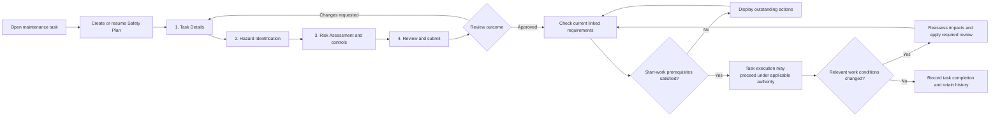
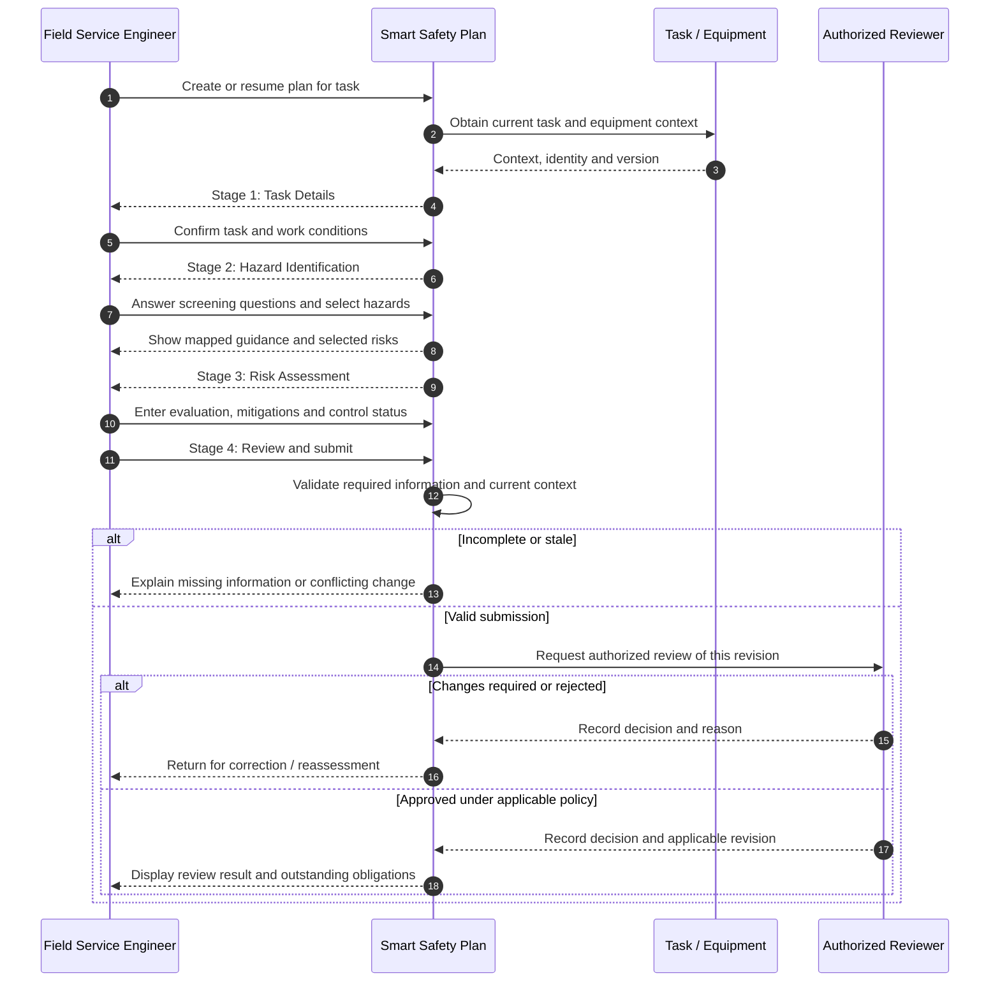
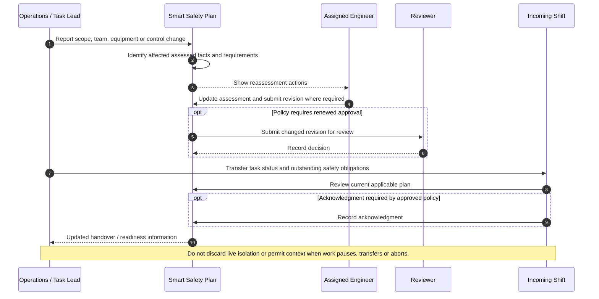
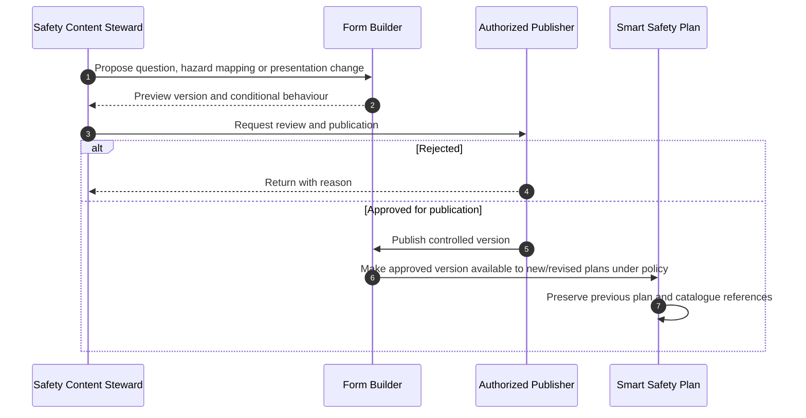
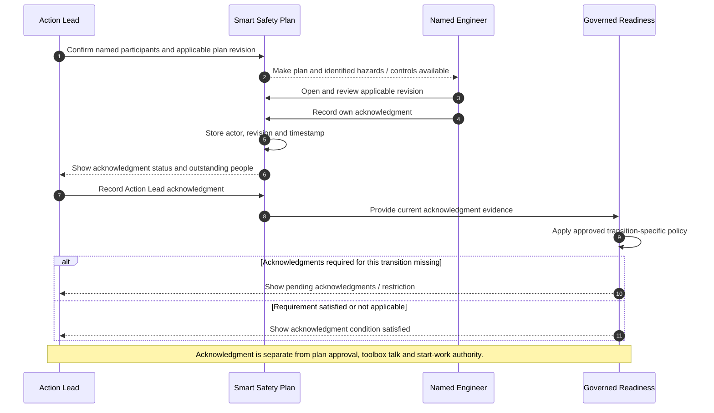

# SAF-001 — User Workflows and Swimlanes (v0)

**Status:** Draft — for product, operations and safety review.  
**Companion:** [Executive PRD](SAF-001-Executive-PRD.md) · [Technical PRD](SAF-001-Technical-PRD.md) · [Decision Register](02-decision-register.md)

These diagrams express **proposed user journeys**, not an approved authorization policy. A system readiness notice is not proof of physical isolation or permission to work. Exact approver, acknowledgment, SRB, PTW and LOTO rules remain decisions to confirm.

## 1. End-to-end user journey



## 2. Swimlane — plan preparation and review



## 3. Swimlane — readiness and work execution

```mermaid
sequenceDiagram
  autonumber
  participant E as Task Lead / Engineer
  participant T as Task Workspace
  participant S as Safety Plan
  participant C as Independent Controls
  participant G as Governed Authorization
  E->>T: Request Start Work or restart
  T->>S: Check current plan revision and decision
  S-->>T: Plan outcome and obligations
  T->>C: Request PTW, LOTO, PPE and competence states where relevant
  C-->>T: Verified / pending / unknown states
  T->>G: Evaluate permitted task transition
  alt Requirement unsatisfied or unverifiable
    G-->>T: Deny transition with reason
    T-->>E: Show outstanding actions and readiness notice
  else All applicable prerequisites accepted
    G-->>T: Permit transition
    T-->>E: Work execution available
  end
  Note over E,G: Exact start/restart and in-progress rules require approval; digital checks do not replace physical verification.
```

## 4. Swimlane — material change and shift handover



## 5. Swimlane — governed question/template publication



## 6. Journey traceability

| Workflow | Primary participants | Related requirements | Decision still open |
|---|---|---|---|
| Create / screen / assess / review | Engineer, Task, Reviewer | SAF-REQ-001–011, 021–024, 027, 032 | Exact catalogue and review authority |
| Check start/restart | Task Lead, Plan, PTW/LOTO, authorization service | SAF-REQ-009–012, 025, 030 | Gate differences by task transition |
| Change and handover | Operations, Engineer, Reviewer, incoming shift | SAF-REQ-013–015, 017, 028–030 | Revision and acknowledgment policy |
| Form definition publication | Steward, publisher, plan | SAF-REQ-018, 021–024, 026, 028, 031 | Builder permissions and version migration |

## 7. Acceptance checkpoints

- Each handoff or decision identifies the actor, current plan revision and relevant task.
- Draft save and submission are different operations; drafts may be incomplete.
- The question set and guidance come from an approved catalogue; unanswered is not No.
- Screen visibility changes do not implicitly erase saved answers.
- Review and start-work permissions are verified by trusted policy, not inferred from the UI.
- Denied or unavailable actions show actionable reasons without recording false success.
- Superseded reviews and source definitions remain reconstructable.
- All exception branches receive corresponding acceptance scenarios.

**Review gate:** Approve these journeys only after the exact safety policy, role matrix, source questions, risk methodology and SRB/PTW/LOTO interaction rules are resolved.

## 8. Swimlane — participant Safety Plan acknowledgment (proposed)



**Decision to approve:** exact minimum for one-person and multi-person tasks, late participants, reacknowledgment on material revision, and treatment of already-running work. Historical one-person and in-progress rulings remain candidates, not automatically binding.

**Linked requirements:** SAF-REQ-017, SAF-REQ-030; BR-058–BR-065.
